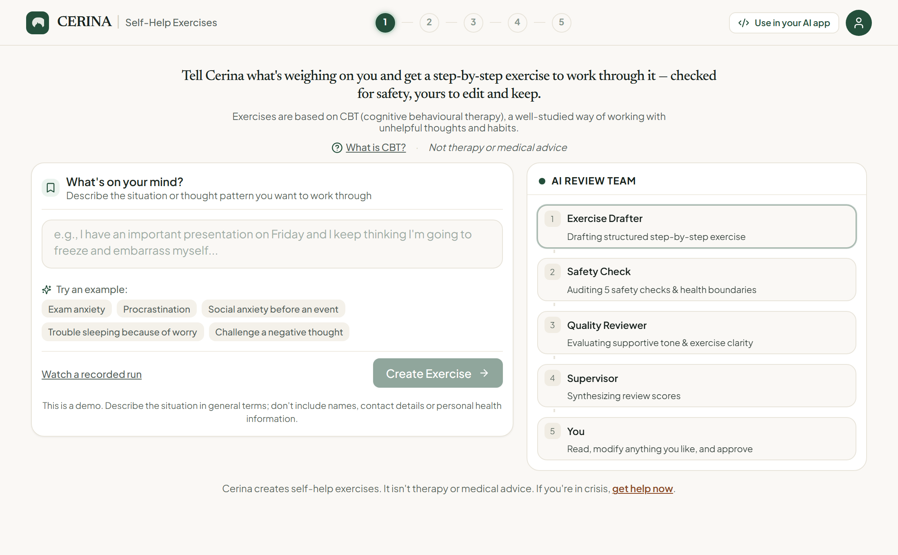
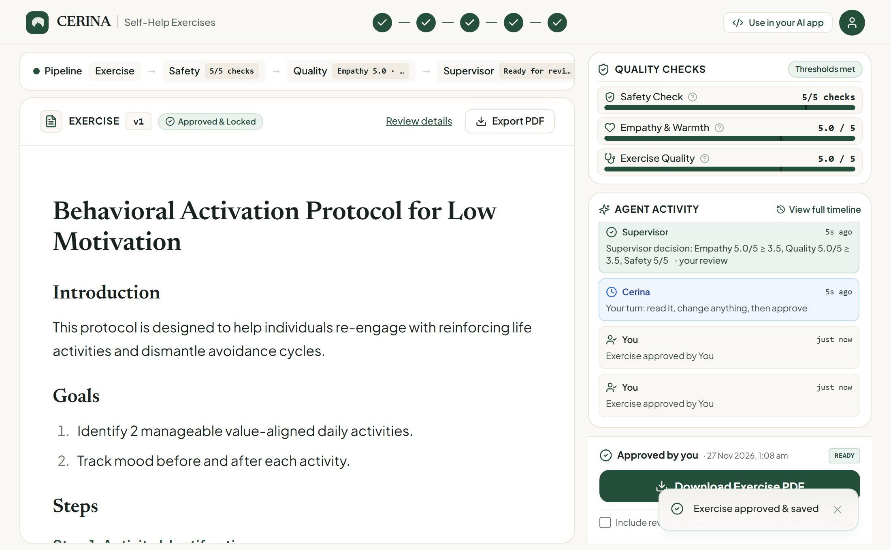
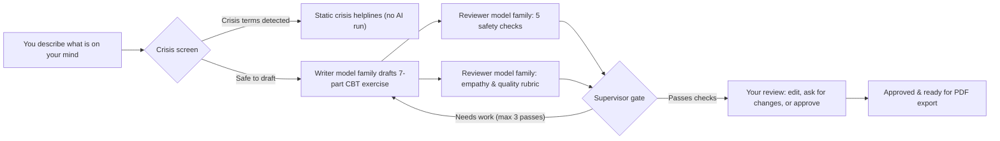

# Cerina

[](https://github.com/Danish137/cerina-protocol-foundry/actions/workflows/ci.yml)

**Live app:** https://cerina-protocol-foundry.vercel.app/

Tell Cerina what is weighing on you and get a structured, step-by-step self-help exercise you can read, edit, and save—checked for safety before it reaches your screen.

Exercises are based on **CBT (cognitive behavioural therapy)**, a practical, well-studied approach for working through unhelpful thoughts, worry loops, and avoidance habits.

---

## Screenshots

| Home screen | Approved exercise |
|---|---|
|  |  |

---

## How it works



1. **Crisis screening first:** Before any AI model runs, deterministic keyword screening checks for acute self-harm or crisis signals and routes straight to localized crisis helplines ([`backend/crisis.py`](backend/crisis.py)).
2. **Separated writer and reviewer families:** One model family drafts the exercise; a different model family grades safety and quality so a model never grades its own work ([`backend/config.py`](backend/config.py), [`backend/llm_client.py`](backend/llm_client.py)).
3. **Human review as the final gate:** You can inspect the safety checks, edit any section directly in the browser, request a targeted revision, or approve and export to PDF ([`frontend/src/components/ActionPanel.tsx`](frontend/src/components/ActionPanel.tsx)).

---

## Safety design

* **Fail-closed safety checks:** The safety pass checks 5 boundaries (no self-harm facilitation, no medication dosing/advice, no clinical diagnosis, no contraindicated exposure steps, and inclusion of professional referral language). If checks fail, time out, or are unavailable, the session is marked `recheck_required` and approval is blocked until re-checked ([`backend/runner.py`](backend/runner.py), [`backend/main.py`](backend/main.py)).
* **Quote-grounded quality review:** The quality reviewer must cite verbatim quotes from the draft alongside scores for warmth, validation, clarity, CBT fidelity, and structure ([`backend/rubrics.py`](backend/rubrics.py)).
* **Static crisis fallback:** Both the backend crisis screen and the frontend React `ErrorBoundary` keep crisis helpline numbers (988 US, Tele-MANAS 14416 India, Samaritans 116 123 UK/IE, and `findahelpline.com`) available even when the API or state fails ([`frontend/src/components/ErrorBoundary.tsx`](frontend/src/components/ErrorBoundary.tsx)).

---

## Privacy and limits

* **No accounts:** There is no sign-up or email login. Each new session issues a random `session_id` and bearer `session_token` once; the backend stores only the SHA-256 hash (`token_hash`) and compares hashes in constant time ([`backend/security.py`](backend/security.py)).
* **7-day retention:** On server startup, sessions older than `SESSION_TTL_DAYS` (default `7`) are purged from `protocol_sessions`, `events`, and LangGraph checkpoint tables, followed by `PRAGMA wal_checkpoint(TRUNCATE)` ([`backend/security.py`](backend/security.py)).
* **Not medical advice:** Cerina generates self-help CBT exercises for personal reflection and demonstration purposes; it is not therapy, diagnosis, or medical care.
* **Daily capacity guard:** A global daily budget protects free-tier provider quotas and reports remaining capacity via `/api/capacity` ([`backend/security.py`](backend/security.py)).
* **MCP per-IP limits:** The hosted MCP endpoint enforces a daily run limit per IP (`MCP_DAILY_RUNS_PER_IP`, default `5`), a maximum of one active run per IP, burst rate limiting, and a per-run revision cap (`MCP_MAX_REVISIONS_PER_RUN`, default `3`) ([`backend/hosted_mcp.py`](backend/hosted_mcp.py)). *Note: if you connect from shared hosting, corporate VPNs, or NAT gateways, multiple users may share the same egress IP and hit these per-IP limits together.*

---

## Use it in your AI app (MCP)

Cerina exposes a hosted **Streamable HTTP MCP** endpoint inside the same FastAPI backend—no local clone required:

```text
https://cerina-protocol-foundry-production.up.railway.app/mcp
```

*Generic setup:* In any MCP-compatible client that supports Streamable HTTP remote servers, add the URL above as a remote MCP server. (Specific third-party client UI steps vary by app version and are not separately automated/verified in CI.)

### Available MCP tools (5)

| Tool | Inputs | What it does |
|---|---|---|
| `create_exercise` | `situation`, `goal` (optional) | Screens for crisis signals; starts a new exercise run and returns `run_id` + `run_token`. |
| `get_status` | `run_id`, `run_token` | Returns plain-language stage (`Writing your exercise`, `Safety check`, `Quality review`, `Ready for your review`, `Needs recheck`, `Approved`, `Failed`). |
| `get_exercise` | `run_id`, `run_token` | Returns the sanitized draft markdown and latest valid safety/quality summary scores. |
| `revise_exercise` | `run_id`, `run_token`, `change_request` | Requests a targeted revision (capped by `MCP_MAX_REVISIONS_PER_RUN`). |
| `approve_exercise` | `run_id`, `run_token` | Finalizes and locks the exercise once reviews are complete and `recheck_required` is clear. |

A legacy local stdio bridge is also present in [`mcp_server/server.py`](mcp_server/server.py) for local development.

---

## Tech stack

* **Backend:** Python 3.11 (containerized), FastAPI, Uvicorn (single worker), LangGraph + `langgraph-checkpoint-sqlite`, SQLAlchemy + SQLite (WAL mode), `mcp` SDK (`1.30.0` Streamable HTTP), `slowapi`
* **Frontend:** React 18, TypeScript, Vite, Tailwind CSS, TipTap rich markdown editor, `@react-pdf/renderer`, `@microsoft/fetch-event-source`
* **Testing & CI:** `pytest` (25 backend tests), `vitest` + React Testing Library (25 frontend tests), GitHub Actions

---

## Local run

### 1. Backend

Environment variables are listed in [`backend/env.template`](backend/env.template):

* The two provider API key variables defined in `backend/env.template` (for the writer and reviewer model families)
* `SESSION_SECRET` (required in production; set a random string locally too)
* Optional: `PORT` (default `8000`), `DATABASE_URL` (default `sqlite:///./cerina_foundry.db`), `MCP_DAILY_RUNS_PER_IP` (default `5`), `MCP_MAX_REVISIONS_PER_RUN` (default `3`)

```bash
cd backend
python -m venv venv
# Windows: .\venv\Scripts\activate  |  macOS/Linux: source venv/bin/activate
pip install -r requirements.txt
cp env.template .env
# Add your API keys and SESSION_SECRET to .env
uvicorn main:app --host 0.0.0.0 --port 8000
```

> **Single worker required:** Run Uvicorn with a single worker (`--workers 1`, the default). Active run tasks and live SSE subscriber queues live in an in-process `RunnerRegistry` ([`backend/runner.py`](backend/runner.py)).

### 2. Frontend

```bash
cd frontend
npm ci
npm run dev
```

Open `http://localhost:3000` (or the port printed by Vite).

---

## Tests

```bash
# Backend (25 tests, uses fakes and temp DB — zero real LLM calls)
pytest tests

# Frontend (25 tests across 6 files)
npm --prefix frontend test -- --run

# Production frontend build check
npm --prefix frontend run build
```

---

## Project structure

Top two levels of tracked files (`git ls-files`):

```text
.
├── .dockerignore
├── .env.example
├── .github/workflows/
├── .gitignore
├── README.md
├── assets/screenshots/
├── backend/
│   ├── agents/
│   ├── config/
│   ├── Dockerfile
│   ├── config.py
│   ├── crisis.py
│   ├── database.py
│   ├── env.template
│   ├── hosted_mcp.py
│   ├── llm_client.py
│   ├── main.py
│   ├── models.py
│   ├── normalizer.py
│   ├── requirements.txt
│   ├── rubrics.py
│   ├── runner.py
│   ├── security.py
│   └── utils.py
├── docs/
│   ├── ARCHITECTURE.md
│   ├── BENCHMARKS.md
│   ├── CHALLENGES.md
│   └── DESIGN_DECISIONS.md
├── frontend/
│   ├── public/
│   ├── src/
│   ├── .env.production
│   ├── index.html
│   ├── package-lock.json
│   ├── package.json
│   ├── postcss.config.js
│   ├── tailwind.config.js
│   ├── tsconfig.json
│   ├── tsconfig.node.json
│   └── vite.config.ts
├── mcp_server/
│   ├── __init__.py
│   ├── requirements.txt
│   └── server.py
├── requirements.txt
└── tests/
    ├── conftest.py
    ├── test_hosted_mcp.py
    ├── test_review_status.py
    └── test_revision_robustness.py
```

---

## Documentation

* [Architecture](docs/ARCHITECTURE.md) — system components, pipeline & session state diagrams, SSE + polling, storage, and MCP mount
* [Benchmarks](docs/BENCHMARKS.md) — aggregates from development data, bundle sizes, test counts, and evaluation design
* [Design Decisions](docs/DESIGN_DECISIONS.md) — 10 key architectural choices and trade-offs
* [Challenges](docs/CHALLENGES.md) — real bugs and fixes from git/PR history

---

## Contributing

* Use **Conventional Commits** (`feat:`, `fix:`, `docs:`, `ci:`, `chore:`).
* Keep branches short-lived and focused; open a PR against `main`.
* Merge via **Squash and merge** once CI passes, then delete the branch.

*(No `LICENSE` file is currently present in this repository.)*
