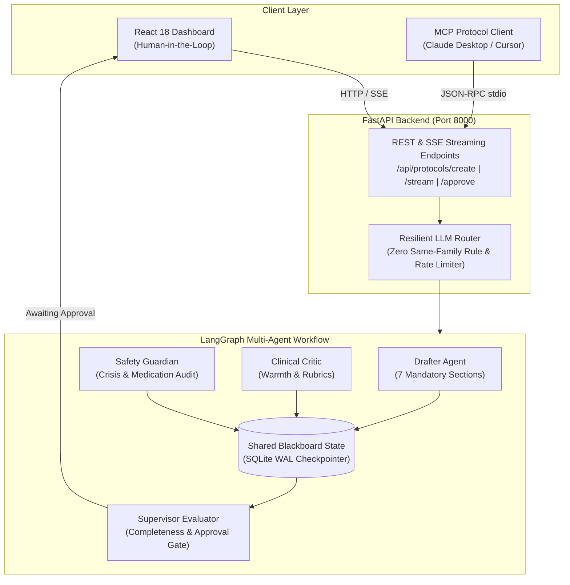

# Cerina Protocol Foundry

An autonomous multi-agent clinical drafting system that designs, audits, and iteratively refines evidence-based Cognitive Behavioral Therapy (CBT) exercises with deterministic safety gates, real-time token streaming, and human-in-the-loop review.

---

## Architecture Diagram



### System Architecture Overview

```
┌────────────────────────────────────────────────────────────────────────┐
│                          USER INTERFACE LAYER                          │
├──────────────────────────────┬─────────────────────────────────────────┤
│   React 18 / Vite Dashboard  │               MCP Client                │
│    (Human-in-the-Loop Review)│          (Machine-to-Machine)           │
│   - Real-time SSE streaming  │     - Claude Desktop / Cursor IDE       │
│   - Split-screen rich editor │     - Programmatic tool execution       │
│   - Score rubrics & metrics  │     - Autonomous protocol generation    │
└──────────────┬───────────────┴────────────────────┬────────────────────┘
               │                                    │
               │ HTTP / SSE                         │ JSON-RPC (stdio)
               │                                    │
┌──────────────▼────────────────────────────────────▼────────────────────┐
│                            FASTAPI BACKEND                             │
│   - Endpoints: /create, /{id}/stream, /{id}/state, /{id}/approve       │
│   - Resilient LLM Router: Pre-flight rate limits & failover            │
│   - Zero Same-Family Rule: Drafter model never grades its own draft    │
└──────────────────────────────┬─────────────────────────────────────────┘
                               │
                   ┌───────────▼───────────┐
                   │   LANGGRAPH WORKFLOW  │
                   │  (Supervisor-Worker)  │
                   └───────────┬───────────┘
                               │
           ┌───────────────────┼───────────────────┐
           │                   │                   │
   ┌───────▼────────┐  ┌───────▼────────┐  ┌───────▼────────┐
   │  DRAFTER       │  │ SAFETY         │  │ CLINICAL       │
   │  AGENT         │  │ GUARDIAN       │  │ CRITIC         │
   │ - 7 Sections   │  │ - Medication   │  │ - CBT Fidelity │
   │ - Revisions    │  │ - Crisis Lines │  │ - Warmth/Tone  │
   │ - Token Stream │  │ - 1-5 Rubric   │  │ - Verbatim Cit.│
   └───────┬────────┘  └───────┬────────┘  └───────┬────────┘
           │                   │                   │
           └───────────────────┼───────────────────┘
                               │
                       ┌───────▼────────┐
                       │  SUPERVISOR    │
                       │  AGENT         │
                       │ - Completeness │
                       │ - 3 Iterations │
                       │ - Approval Gate│
                       └───────┬────────┘
                               │
                   ┌───────────▼───────────┐
                   │  SHARED STATE (DB)    │
                   │  - Blackboard State   │
                   │  - SQLite WAL Journal │
                   │  - Audit History      │
                   └───────────────────────┘
```

---

## Key Agent Roles & Workflow

1. **Protocol Drafter**: Synthesizes clinical intents into structured CBT protocols with 7 mandatory sections:
   - `# Title`
   - `## Introduction / Clinical Rationale`
   - `## Measurable Goals`
   - `## Step-by-Step Instructions`
   - `## Guided Practice / Exposure Hierarchy`
   - `## Reflection / Thought Record`
   - `## Conclusion & Emergency Support`
2. **Safety Guardian**: Evaluates contraindications, medication risks, and crisis hotline adherence (988, 111, Samaritans, Crisis Text Line) using quote-grounded 1–5 rubrics.
3. **Clinical Critic**: Evaluates therapeutic warmth, fidelity to CBT principles, structural clarity, and actionable exercises with verbatim quote verification to eliminate rubber-stamping.
4. **Supervisor Evaluator**: Enforces rubric thresholds, deterministic completeness checks, iteration caps (max 3 revisions), and failure-closed outage gates before routing to human approval.
5. **Zero Same-Family Rule**: A model family is strictly barred from grading its own output:
   - **Groq writer** (`openai/gpt-oss-120b`) -> Evaluated by **Google Gemini** or **Meta Llama**.
   - **Gemini writer** (`gemini-3.1-flash-lite`) -> Evaluated by **Groq Qwen** or **Meta Llama**.

---

## How to Run

### Prerequisites
- **Python 3.11+**
- **Node.js 18+** & **npm**
- Provider API keys:
  - `GROQ_API_KEY` (Free tier from [console.groq.com](https://console.groq.com))
  - `GOOGLE_API_KEY` (Free tier from [aistudio.google.com](https://aistudio.google.com))

---

### Step 1: Backend Setup & Launch

1. Open a terminal and navigate to `backend/`:
   ```bash
   cd backend
   ```

2. Create and activate a Python virtual environment:
   ```bash
   # Windows (PowerShell)
   python -m venv venv
   .\venv\Scripts\activate

   # macOS / Linux
   python3 -m venv venv
   source venv/bin/activate
   ```

3. Install dependencies:
   ```bash
   pip install -r requirements.txt
   ```

4. Configure your `.env` file in `backend/.env`:
   ```env
   GROQ_API_KEY=gsk_your_groq_api_key_here
   GOOGLE_API_KEY=AIzaSy_your_google_api_key_here

   # Optional defaults
   HOST=0.0.0.0
   PORT=8000
   DATABASE_URL=sqlite:///./cerina_foundry.db
   ```

5. Start the backend server:
   ```bash
   uvicorn main:app --host 0.0.0.0 --port 8000 --reload
   ```
   *The backend API and interactive docs will now be live at http://localhost:8000/docs.*

---

### Step 2: Frontend Setup & Launch

1. Open a separate terminal and navigate to `frontend/`:
   ```bash
   cd frontend
   ```

2. Install dependencies:
   ```bash
   npm install
   ```

3. Start the development server:
   ```bash
   npm run dev
   ```

4. Open your browser at **`http://localhost:3000`**. You can enter a clinical intent (e.g. *"Design a gradual exposure hierarchy for elevator phobia"*) and observe the multi-agent generation in real-time.

---

## How to Use MCP (Model Context Protocol)

Cerina Protocol Foundry includes a full **Model Context Protocol (MCP)** stdio server located in `mcp_server/server.py`. This allows external AI clients like **Claude Desktop**, **Cursor IDE**, or CLI agents to autonomously generate, inspect, and approve clinical protocols.

### 1. Configure Claude Desktop

Locate or create your Claude Desktop configuration file:
- **macOS**: `~/Library/Application Support/Claude/claude_desktop_config.json`
- **Windows**: `%APPDATA%\Claude\claude_desktop_config.json`

Add the `cerina-protocol-foundry` server definition:

```json
{
  "mcpServers": {
    "cerina-protocol-foundry": {
      "command": "python",
      "args": [
        "d:/Projects/Cerina-Protocol-Foundary/mcp_server/server.py"
      ],
      "env": {
        "BACKEND_URL": "http://localhost:8000"
      }
    }
  }
}
```
*(Replace `d:/Projects/Cerina-Protocol-Foundary` with the absolute path to your repository).*

### 2. Available MCP Tools

Once connected, your MCP client gains access to the following 4 tools:

| Tool Name | Parameters | Description |
|---|---|---|
| `create_cbt_protocol` | `intent` (string, required)<br>`session_id` (string, optional) | Initiates the autonomous multi-agent drafting and critique pipeline. Returns session ID and current draft status. |
| `get_protocol_status` | `session_id` (string, required) | Retrieves the current state, draft content, rubric scores, iteration count, and review status. |
| `approve_protocol` | `session_id` (string, required)<br>`edited_draft` (string, optional) | Approves the protocol (human-in-the-loop sign-off) and applies optional clinician edits. |
| `list_protocols` | `limit` (integer, optional, default: 10) | Lists recent protocol sessions with their status, timestamps, and intents. |

### 3. Example Prompt for Claude Desktop / Cursor

You can prompt Claude Desktop directly:

> *"Use the Cerina Protocol Foundry to create a stimulus control and sleep hygiene protocol for sleep-onset insomnia."*

Claude will call `create_cbt_protocol`, inspect the scores with `get_protocol_status`, and present the drafted protocol for your review!

---
