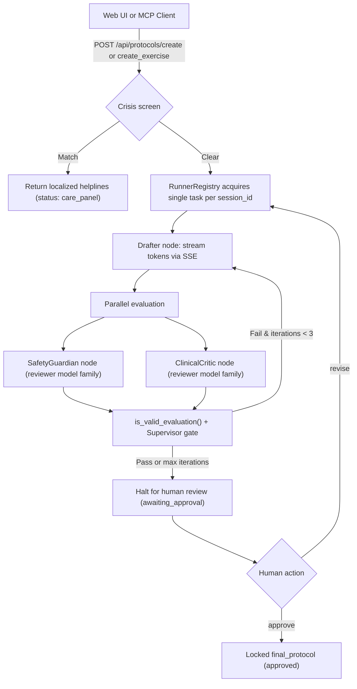
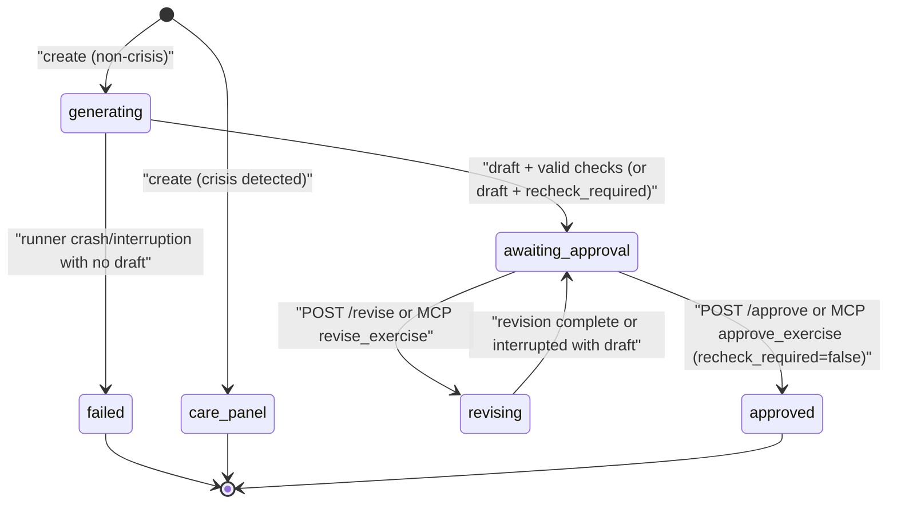

# Architecture

## System Overview

Cerina is a single-service FastAPI backend paired with a React 18 SPA frontend. The backend hosts:

1. **REST + SSE API** ([`backend/main.py`](../backend/main.py)) for the web client.
2. **Hosted Streamable HTTP MCP Server** mounted at `/mcp` ([`backend/hosted_mcp.py`](../backend/hosted_mcp.py)) using `FastMCP(..., stateless_http=True)`.
3. **Single-Worker Runner & Event Bus** ([`backend/runner.py`](../backend/runner.py)) owning LangGraph execution and in-process SSE fan-out.
4. **Multi-Agent Workflow & LLM Router** ([`backend/agents/workflow.py`](../backend/agents/workflow.py), [`backend/llm_client.py`](../backend/llm_client.py)) enforcing writer/reviewer model-family separation.
5. **SQLite Persistence (WAL mode)** ([`backend/database.py`](../backend/database.py)) for sessions, append-only events, usage counters, and LangGraph checkpoints.

---

## Pipeline Data Flow

1. **Create & Auth:** `POST /api/protocols/create` (or MCP `create_exercise`) checks the daily capacity guard (`get_capacity_status()`), runs deterministic crisis screening (`screen_crisis_intent()`), generates a `session_id` and raw `session_token`, stores `hash_token(session_token)` in `protocol_sessions`, and schedules `run_protocol_workflow` via `RunnerRegistry.acquire_or_raise()`.
2. **Live Streaming + Durable Events:** As the Drafter generates text, `token` events are broadcast live to in-process SSE subscribers without writing every token to SQLite. Node lifecycle (`node_start`, `node_end`), `draft`, `score`, `decision`, `checkpoint`, `error`, and `run_end` events are persisted synchronously to the `events` table with monotonic `(session_id, seq)` numbers (`emit_event()`).
3. **Resilient Polling Fallback:** If an SSE stream disconnects or ends cleanly while a run is still in progress, the frontend [`sseClient.ts`](../frontend/src/services/sseClient.ts) falls back to polling `GET /api/protocols/{session_id}/events?after={seq}` and `GET /api/protocols/{session_id}/state`.
4. **Fail-Closed Completion:** In `run_protocol_workflow`'s `finally` block and in `reconcile_interrupted_sessions()` on startup ([`backend/runner.py`](../backend/runner.py)), `is_valid_evaluation(db, session_id, draft_version)` checks for completed, non-unverified `SafetyGuardian` and `ClinicalCritic` `score` events. If a draft exists without valid checks, `recheck_required` is set to `True` in `meta_data`, blocking approval until re-checked.

---

## Session State Machine

*Note:* The web UI and `/state` endpoint map raw backend statuses (`generating`, `revising`, `awaiting_approval`, `approved`, `failed`, `care_panel`) and `meta_data.recheck_required` into plain-language labels. MCP `get_status` maps `awaiting_approval` to `"Ready for your review"` **only** when `recheck_required` is false and `is_valid_evaluation(... )["fully_checked"]` is true ([`backend/hosted_mcp.py`](../backend/hosted_mcp.py)).

---

## Storage Tables

Defined in [`backend/database.py`](../backend/database.py) and LangGraph's `SqliteSaver`:

| Table | Purpose | Key Columns |
|---|---|---|
| `protocol_sessions` | Session state, hashed auth token, draft & final text | `session_id` (unique), `token_hash`, `status`, `current_draft`, `final_protocol`, `meta_data` (JSON), `created_at`, `updated_at` |
| `events` | Append-only audit & replay log | `(session_id, seq)` unique, `run_id`, `run_kind`, `draft_version`, `agent`, `type`, `text`, `data` (JSON), `ts` |
| `llm_usage` | Daily capacity guard counters | `session_id`, `model`, `call_type`, `prompt_tokens`, `completion_tokens`, `total_tokens`, `latency_ms`, `created_at` |
| `agent_activities` | Legacy activity log table retained for compatibility | `session_id`, `agent_name`, `action`, `reasoning`, `timestamp` |
| `checkpoints` / `writes` | LangGraph `SqliteSaver` graph state tables | `thread_id` (matches `session_id`) |

---

## Deployment & Hosted MCP Mount

* **Frontend:** Deployed on **Vercel** (`https://cerina-protocol-foundry.vercel.app`), built from `frontend/` with `VITE_API_URL` pointing to the Railway backend.
* **Backend:** Deployed on **Railway** using [`backend/Dockerfile`](../backend/Dockerfile) (`python:3.11-slim`), running `uvicorn main:app --host 0.0.0.0 --port 8000` (single worker) with a persistent volume mounted at `/app/data` (`DATABASE_URL` points to SQLite on the volume).
* **Hosted MCP:** Mounted at `/mcp` inside the same FastAPI app (`app.mount("/mcp", hosted_mcp.streamable_http_app())`) in stateless Streamable HTTP mode, with `hosted_mcp.session_manager.run()` managed inside FastAPI's `lifespan` ([`backend/main.py`](../backend/main.py), [`backend/hosted_mcp.py`](../backend/hosted_mcp.py)). Host/origin protection allows `localhost`, `127.0.0.1`, the Railway domain, and the Vercel origin.
