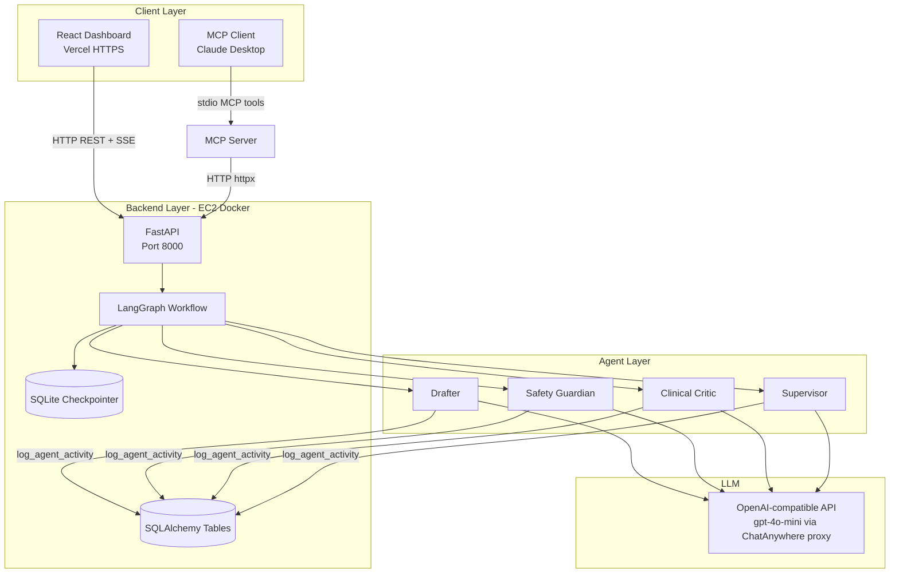

# Cerina Protocol Foundry — Technical Reference

> **Single source of truth** for architecture, implementation, APIs, persistence, MCP integration, and deployment.  
> Last aligned with codebase: July 2026.

---

## Table of Contents

1. [What This Project Does](#1-what-this-project-does)
2. [High-Level Architecture](#2-high-level-architecture)
3. [Technology Stack](#3-technology-stack)
4. [Repository Layout](#4-repository-layout)
5. [Multi-Agent System](#5-multi-agent-system)
6. [LangGraph Workflow](#6-langgraph-workflow)
7. [Shared State (Blackboard Pattern)](#7-shared-state-blackboard-pattern)
8. [Database & Persistence](#8-database--persistence)
9. [Backend API (FastAPI)](#9-backend-api-fastapi)
10. [Real-Time Streaming (SSE)](#10-real-time-streaming-sse)
11. [Frontend (React + Vite)](#11-frontend-react--vite)
12. [MCP Server Integration](#12-mcp-server-integration)
13. [LLM Configuration](#13-llm-configuration)
14. [Environment Variables](#14-environment-variables)
15. [Local Development](#15-local-development)
16. [Production Deployment](#16-production-deployment)
17. [End-to-End Request Flows](#17-end-to-end-request-flows)
18. [Human-in-the-Loop (HITL)](#18-human-in-the-loop-hitl)
19. [Known Limitations & Implementation Notes](#19-known-limitations--implementation-notes)
20. [Glossary](#20-glossary)

---

## 1. What This Project Does

**Cerina Protocol Foundry** is an autonomous **multi-agent system** that designs, critiques, and refines **CBT (Cognitive Behavioral Therapy) exercise protocols**.

A user (or an MCP client like Claude Desktop) submits a natural-language **intent** — for example: *"Create a sleep hygiene routine for insomnia."* The system then:

1. **Drafts** a structured CBT exercise using an LLM-powered Drafter agent.
2. **Reviews** it for safety (Safety Guardian) and clinical quality (Clinical Critic).
3. **Decides** whether to iterate or pause (Supervisor).
4. **Pauses for human approval** when quality thresholds are met (or max iterations reached).
5. Lets a human **review, edit, and approve** the draft via the React dashboard (or MCP).
6. **Finalizes** the protocol after approval.

The system is built for **demonstrating agentic AI patterns**: supervisor–worker orchestration, shared blackboard state, checkpointed workflows, SSE real-time UI, and MCP tool exposure.

**Live demo:** [Loom recording](https://www.loom.com/share/68516d1760b64d8a9d7f4563413a0e52)

---

## 2. High-Level Architecture



### ASCII diagram (also in `ARCHITECTURE_DIAGRAM.txt`)

```
User Interface Layer
├── React Dashboard (Human-in-the-Loop) ── HTTP/SSE ──┐
└── MCP Client (Machine-to-Machine) ── MCP stdio ── MCP Server ── HTTP ──┤
                                                                          │
FastAPI Backend ◄─────────────────────────────────────────────────────────┘
    │
    └── LangGraph Workflow
            ├── Drafter → Safety Guardian → Clinical Critic → Supervisor
            │       ↑___________________________________________|
            │              (needs_revision loop)
            └── Shared State (Blackboard) → SQLite Checkpointer
```

### Design pattern: Supervisor–Worker

| Role | Agent | Responsibility |
|------|-------|----------------|
| Worker | **Drafter** | Generate and revise CBT draft text |
| Worker | **Safety Guardian** | Safety score, flag self-harm / medical advice |
| Worker | **Clinical Critic** | Empathy + clinical quality scores |
| Supervisor | **Supervisor** | Threshold checks, iteration control, halt for HITL |

Workers produce output; the Supervisor **routes** the graph — it does not rewrite content itself.

---

## 3. Technology Stack

| Layer | Technology | Purpose |
|-------|------------|---------|
| Orchestration | **LangGraph** | Multi-agent state machine, conditional routing, checkpointing |
| LLM | **LangChain + ChatOpenAI** | Agent prompts and async LLM calls |
| API | **FastAPI + Uvicorn** | REST endpoints, SSE streaming, CORS |
| Validation | **Pydantic v2** | Request/response models |
| Persistence | **SQLite** (dual use) | LangGraph checkpoints + SQLAlchemy audit tables |
| Frontend | **React 18 + TypeScript + Vite 5** | Dashboard UI |
| Styling | **Tailwind CSS 3** | UI theming |
| HTTP client | **Axios** | Frontend API calls |
| PDF export | **jsPDF** | Client-side protocol export |
| MCP | **MCP Python SDK + httpx** | Tool server over stdio |
| Container | **Docker + docker-compose** | Backend deployment on EC2 |

### What is **not** used in current code (despite appearing in docs/deps)

| Item | Status |
|------|--------|
| **Groq API** | Referenced in older docs/docker-compose; **not used in Python source** |
| `sse-starlette` | Listed in `requirements.txt`; backend uses FastAPI `StreamingResponse` instead |
| `react-router-dom`, `zustand`, `html2canvas` | In `package.json` but **not imported** in frontend source |
| `ProtocolSession` SQLAlchemy table | Schema exists; **no API route reads/writes it** |

---

## 4. Repository Layout

```
Cerina-Protocol-Foundary/
├── backend/
│   ├── main.py                 # FastAPI app, routes, SSE, lifespan
│   ├── models.py               # Pydantic API models
│   ├── database.py             # SQLAlchemy models + init_db()
│   ├── utils.py                # log_agent_activity()
│   ├── agents/
│   │   ├── state.py            # ProtocolState TypedDict (blackboard)
│   │   ├── agents.py           # Drafter, SafetyGuardian, ClinicalCritic, Supervisor
│   │   └── workflow.py         # LangGraph graph + checkpointer
│   ├── Dockerfile
│   ├── env.template            # Environment variable template
│   └── requirements.txt
├── frontend/
│   └── src/
│       ├── App.tsx
│       ├── config.ts           # VITE_API_URL → backend base URL
│       └── components/
│           ├── ProtocolCreator.tsx
│           ├── ProtocolViewer.tsx
│           └── AgentActivityFeed.tsx
├── mcp_server/
│   └── server.py               # MCP stdio server → HTTP proxy to backend
├── docker-compose.yml          # Backend-only compose file
├── ARCHITECTURE_DIAGRAM.txt    # ASCII architecture reference
└── docs/                       # Additional guides (ARCHITECTURE, SETUP, USAGE, etc.)
```

---

## 5. Multi-Agent System

All agents live in `backend/agents/agents.py`. Each agent:

- Instantiates `ChatOpenAI` via `get_llm()`.
- Uses structured **system + human** prompts.
- Writes to the shared blackboard via `add_agent_note()`.
- Logs actions to `agent_activities` via `log_agent_activity()`.

### 5.1 Drafter Agent

**Purpose:** Create initial and revised CBT exercise drafts.

**Inputs:**
- `user_intent` from state
- Recent `agent_notes` where `target_agent == "Drafter"`
- `iteration_count` for revision context

**Output fields:**
```python
{
  "current_draft": "<markdown/text protocol>",
  "active_agent": "Drafter",
  "status": "drafting"
}
```

**Prompt guidelines enforced:** structured sections, warm tone, no medical advice, evidence-based CBT, actionable steps.

### 5.2 Safety Guardian Agent

**Purpose:** Detect safety risks in draft content.

**Checks:** self-harm/suicide references, medical advice, dangerous practices.

**LLM response format (JSON preferred):**
```json
{
  "safe": true,
  "safety_score": 0.0,
  "issues": [],
  "recommendations": []
}
```

If JSON parsing fails, a **fallback heuristic** assigns score 0.8 or 0.3 based on keyword matching.

**On low safety:** adds `priority: "critical"` notes targeted at Drafter.

### 5.3 Clinical Critic Agent

**Purpose:** Evaluate empathy, clinical appropriateness, structure, actionability.

**LLM response format (JSON preferred):**
```json
{
  "empathy_score": 0.0,
  "clinical_score": 0.0,
  "overall_score": 0.0,
  "strengths": [],
  "weaknesses": [],
  "recommendations": []
}
```

**On weaknesses:** adds up to 3 `priority: "warning"` notes targeted at Drafter.

### 5.4 Supervisor Agent

**Purpose:** Orchestration decisions — **no direct LLM routing** in the router; logic is deterministic in code.

**Quality thresholds (hard-coded):**

| Metric | Minimum to pass |
|--------|-----------------|
| Safety score | ≥ **0.8** |
| Empathy score | ≥ **0.7** |
| Clinical score | ≥ **0.7** |
| Max iterations | **5** (default in `create_initial_state`) |

**Decision outcomes:**

| Condition | Result |
|-----------|--------|
| All scores meet thresholds + draft exists | `halted: true`, `status: "ready_for_review"` |
| Any score below threshold + iterations remain | `status: "needs_revision"` → loop to Drafter |
| `iteration_count >= max_iterations` | Halt with `status: "max_iterations_reached"` |
| No draft | Route back to Drafter |

---

## 6. LangGraph Workflow

**File:** `backend/agents/workflow.py`

### Graph topology

```
Entry → draft → safety_review → clinical_critique → supervisor
         ↑______________________________________________|
                    (when status contains "needs_revision")
```

### Nodes

| Node | Function | Agent |
|------|----------|-------|
| `draft` | `draft_node()` | Drafter |
| `safety_review` | `safety_review_node()` | Safety Guardian |
| `clinical_critique` | `clinical_critique_node()` | Clinical Critic |
| `supervisor` | `supervisor_node()` | Supervisor |

Each node merges agent return values into `ProtocolState` and updates `active_agent`, `status`, scores, etc.

### Router: `should_continue()`

After every node, `should_continue(state)` returns the next edge:

| Condition | Route |
|-----------|-------|
| `halted == True` | `"halt"` → **END** |
| `human_approved == True` | `"end"` → **END** |
| `active_agent == "Drafter"` | `"safety_review"` |
| `active_agent == "SafetyGuardian"` | `"clinical_critique"` |
| `active_agent == "ClinicalCritic"` | `"supervisor"` |
| Supervisor + `"needs_revision" in status` | `"draft"` |
| Supervisor + ready/awaiting review | `"halt"` → **END** |
| No draft yet | `"draft"` |

### Checkpointing

- **Sync fallback:** `SqliteSaver` via `sqlite3.connect()`
- **Production path:** `AsyncSqliteSaver` via `aiosqlite` — initialized in FastAPI **lifespan** (`init_checkpointer_async()`)
- **DB path:** from `DATABASE_URL` env var (default `sqlite:///./cerina_foundry.db`)
- **Thread ID:** `session_id` — each protocol session is an isolated checkpoint thread

```python
config = {"configurable": {"thread_id": session_id}}
```

### Workflow factory

```python
workflow = create_workflow()  # compiles StateGraph with checkpointer
```

Each API call creates a **new workflow instance** but reads/writes the **same checkpoint** for a given `session_id`.

---

## 7. Shared State (Blackboard Pattern)

**File:** `backend/agents/state.py`

`ProtocolState` is a `TypedDict` — the **single source of truth** during workflow execution.

### Core fields

| Field | Type | Description |
|-------|------|-------------|
| `user_intent` | `str` | Original user request |
| `session_id` | `str` | Unique session identifier |
| `status` | `str` | Workflow phase (see lifecycle below) |
| `current_draft` | `str \| None` | Latest protocol text |
| `draft_history` | `List[ProtocolDraft]` | Versioned history |
| `current_version` | `int` | Draft version counter |
| `iteration_count` | `int` | Revision cycles completed |
| `max_iterations` | `int` | Safety cap (default 5) |

### Collaboration fields

| Field | Type | Description |
|-------|------|-------------|
| `agent_notes` | `List[AgentNote]` | Blackboard messages between agents |
| `active_agent` | `str \| None` | Last agent that ran |
| `agent_decisions` | `Dict` | Reserved for agent decision metadata |

### Quality fields

| Field | Type | Description |
|-------|------|-------------|
| `safety_checks` | `Dict[str, bool]` | Boolean safety flags |
| `safety_score` | `float \| None` | 0.0–1.0 |
| `empathy_score` | `float \| None` | 0.0–1.0 |
| `clinical_score` | `float \| None` | 0.0–1.0 |

### Human-in-the-loop fields

| Field | Type | Description |
|-------|------|-------------|
| `halted` | `bool` | Workflow paused for review |
| `human_approved` | `bool` | User approved the draft |
| `human_edits` | `str \| None` | Edited content from human |

### Status lifecycle (typical path)

```
initializing → drafting → reviewing → critiquing → deciding
    → awaiting_approval (halted)
    → approved (after human approve)
    → [completed — see limitations]
```

**Note:** The approve endpoint sets `status = "approved"`. The string `"completed"` is checked in stream/approve handlers but **may not always be set** by the Supervisor on workflow end — see [§19](#19-known-limitations--implementation-notes).

### AgentNote structure

```python
AgentNote = {
    "agent_name": str,       # e.g. "SafetyGuardian", "Human", "System"
    "note": str,
    "target_agent": str | None,  # None = broadcast
    "timestamp": datetime,
    "priority": "info" | "warning" | "critical"
}
```

---

## 8. Database & Persistence

The project uses **one SQLite file** for two **independent** persistence mechanisms.

### 8.1 LangGraph SQLite Checkpointer (primary)

- **Purpose:** Full workflow state snapshots per step; enables resume, SSE replay, HITL pause/resume.
- **Managed by:** LangGraph `AsyncSqliteSaver` / `SqliteSaver`
- **Key:** `thread_id` = `session_id`
- **This is the source of truth** for protocol content, scores, and agent notes during a session.

### 8.2 SQLAlchemy ORM tables (secondary / audit)

**File:** `backend/database.py`

#### Table: `protocol_sessions`

| Column | Purpose |
|--------|---------|
| `session_id`, `user_intent`, `status`, `current_draft`, scores, timestamps | Session metadata |

**Status:** Table is **created on startup** but **no API route currently writes to it**. Intended for future session listing.

#### Table: `agent_activities`

| Column | Purpose |
|--------|---------|
| `session_id`, `agent_name`, `action`, `reasoning`, `timestamp`, `state_snapshot` | Audit log |

**Status:** **Actively written** by `log_agent_activity()` from each agent after major actions.

### 8.3 In-memory fallback

**File:** `backend/main.py`

```python
_session_intents: Dict[str, str] = {}
```

If checkpoint creation fails on `POST /create`, the user intent is stored here temporarily until the `/stream` endpoint creates the checkpoint.

### Default database paths

| Environment | `DATABASE_URL` |
|-------------|----------------|
| Local dev | `sqlite:///./cerina_foundry.db` |
| Docker (compose) | `sqlite:///./data/cerina_foundry.db` (volume: `./backend/data:/app/data`) |

---

## 9. Backend API (FastAPI)

**File:** `backend/main.py`  
**Base URL (production):** `http://54.147.175.216:8000`  
**Default bind:** `0.0.0.0:8000`

### Startup lifecycle

1. `init_db()` — create SQLAlchemy tables
2. `init_checkpointer_async()` — open async SQLite checkpointer connection
3. On shutdown: `close_checkpointer_async()`

### CORS allowed origins

```
http://localhost:3000
http://localhost:5173
http://127.0.0.1:3000
http://127.0.0.1:5173
https://cerina-protocol-foundry.vercel.app
https://54.147.175.216
```

### Endpoint reference

#### `GET /`

Health/info response.

```json
{"message": "Cerina Protocol Foundry API", "status": "running"}
```

#### `GET /health`

```json
{"status": "healthy", "timestamp": "2026-07-02T12:00:00"}
```

#### `POST /api/protocols/create`

Start a new protocol generation session.

**Request body:**
```json
{
  "intent": "Create a sleep hygiene routine",
  "session_id": "optional-custom-id",
  "metadata": {}
}
```

**Response:**
```json
{
  "session_id": "session_1770226474.772259",
  "status": "initializing",
  "message": "Protocol generation initialized. Workflow execution started.",
  "timestamp": "2026-07-02T12:00:00"
}
```

**Behavior:**
1. Creates initial `ProtocolState` via `create_initial_state()`.
2. Attempts `aupdate_state()` to seed checkpoint.
3. Stores intent in `_session_intents` if checkpoint fails.
4. Starts `start_workflow_background()` via FastAPI `BackgroundTasks` (for MCP/non-UI clients).
5. UI clients typically also drive execution via `/stream`.

#### `GET /api/protocols/{session_id}/stream`

**Server-Sent Events (SSE)** — real-time workflow updates.

**Response headers:** `Content-Type: text/event-stream`

**Event types:**

| Event | When | Payload |
|-------|------|---------|
| `state_update` | After each graph node | `{ node, state, agent_thought, active_agent, timestamp }` |
| `halted` | Workflow paused for HITL | `{ state, message, timestamp }` |
| `complete` | Workflow finished | `{ state, timestamp }` |
| `error` | Exception | `{ error, detail? }` |

**Behavior:**
- Loads or creates checkpoint for session.
- Runs `workflow.astream(None, config, stream_mode="updates")`.
- Serializes datetime fields to ISO strings before JSON encoding.
- Stops streaming when `halted` or `status == "awaiting_approval"`.

#### `GET /api/protocols/{session_id}/state`

Returns current LangGraph checkpoint state.

```json
{
  "session_id": "session_...",
  "state": { /* full ProtocolState */ },
  "next": [],
  "metadata": {}
}
```

#### `POST /api/protocols/{session_id}/approve`

Human approves draft; optionally submits edited content.

**Request body:**
```json
{
  "approved_content": "optional edited markdown..."
}
```

**Behavior:**
1. Sets `human_approved = true`, `halted = false`, `status = "approved"`.
2. Adds Human agent note.
3. Persists to checkpoint.
4. Calls `workflow.ainvoke(None, config)` — router sees `human_approved` → END.

#### `POST /api/protocols/{session_id}/halt`

Manually pause workflow for review.

**Response:**
```json
{
  "session_id": "...",
  "status": "halted",
  "current_draft": "...",
  "message": "Workflow paused for human review"
}
```

#### `GET /api/protocols`

**Stub implementation** — always returns empty list.

```json
{"protocols": [], "limit": 20, "offset": 0}
```

---

## 10. Real-Time Streaming (SSE)

### Backend implementation

Uses FastAPI `StreamingResponse` with manual SSE formatting:

```
event: state_update
data: {"node":"draft","state":{...},"timestamp":"..."}

```

### Frontend consumption

Both `ProtocolViewer` and `AgentActivityFeed` open **separate** `EventSource` connections to the same `/stream` URL for a session.

**Implication:** Two concurrent SSE consumers per session. Checkpoint state mitigates duplicate execution in many cases, but this is a known architectural consideration (see §19).

### Polling fallback

`AgentActivityFeed` also polls `/state` every **2 seconds** to catch Human/System notes that may arrive outside SSE events.

---

## 11. Frontend (React + Vite)

### Entry & layout

**`App.tsx`** — single-page layout:
- Header with MCP documentation link (GitHub `TEST_MCP.md`)
- Left column: `ProtocolCreator` + `ProtocolViewer`
- Right column: `AgentActivityFeed` (sticky)

### API configuration

**`frontend/src/config.ts`:**

```typescript
const API_BASE_URL = import.meta.env.VITE_API_URL || 'http://54.147.175.216:8000'
export default API_BASE_URL
```

| Environment | How backend URL is resolved |
|-------------|----------------------------|
| **Vercel production** | Set `VITE_API_URL=http://54.147.175.216:8000` in Vercel env vars |
| **Local dev (recommended)** | Set `VITE_API_URL=http://localhost:8000` in `.env.local` |
| **Fallback** | Hardcoded EC2 IP if env var missing |

**Important:** Components use **absolute URLs** (`${API_BASE_URL}/api/...`). The Vite dev proxy in `vite.config.ts` (`/api → localhost:8000`) is **bypassed** unless you omit `API_BASE_URL` and refactor to relative paths.

**Dev server port:** **3000** (configured in `vite.config.ts`, not Vite default 5173).

### Components

#### `ProtocolCreator.tsx`

- Form with intent textarea.
- `POST ${API_BASE_URL}/api/protocols/create`
- On success: calls `onSessionStart({ sessionId, status })`.

#### `ProtocolViewer.tsx`

- Fetches initial state via `GET .../state`.
- Opens SSE `EventSource` on `.../stream`.
- Displays quality score bars (safety, empathy, clinical).
- **HITL UI:** Edit / Approve / Halt buttons when halted.
- **PDF export:** client-side via `jsPDF` (no backend call).

#### `AgentActivityFeed.tsx`

- Maps `agent_notes` and SSE node events to a scrollable activity timeline.
- Agent icon mapping: Drafter, SafetyGuardian, ClinicalCritic, Supervisor, Human, System.
- Priority-based border colors: critical (red), warning (yellow), info (default).

### Production deployment note: Mixed Content

| Frontend | Backend | Browser behavior |
|----------|---------|------------------|
| `https://*.vercel.app` | `http://54.147.175.216:8000` | **Blocked** — mixed content (HTTPS page → HTTP API) |

**Symptoms:** Network tab shows request to correct EC2 URL but **"Provisional headers are shown"**, no response, UI error: *"No response from server."*

**Fixes (pick one):**
1. Put backend behind **HTTPS** (nginx + Let's Encrypt, ALB, Cloudflare).
2. Serve frontend over **HTTP** (not recommended for production).
3. Use **Vercel rewrites** to proxy `/api` to backend (same-origin, no mixed content).

Backend curl from EC2 works; browser from Vercel HTTPS does not — this is a **client-side security restriction**, not a backend bug.

---

## 12. MCP Server Integration

**Location:** `mcp_server/server.py`  
**Transport:** MCP over **stdio** (stdin/stdout) — launched by MCP host (e.g. Claude Desktop), not as a standalone HTTP server.

### Architecture

```
Claude Desktop  ←stdio→  MCP Server (server.py)  ←HTTP→  FastAPI Backend
```

The MCP server is a **thin HTTP client**. It does **not** import LangGraph or agents directly.

### Configuration

| Variable | Default | Purpose |
|----------|---------|---------|
| `BACKEND_URL` | `http://localhost:8000` | FastAPI base URL |

### Exposed tools

| Tool | HTTP mapping | Description |
|------|--------------|-------------|
| `create_cbt_protocol` | `POST /api/protocols/create` | Start generation with `intent`, optional `session_id` |
| `get_protocol_status` | `GET /api/protocols/{id}/state` | Status, scores, current draft |
| `approve_protocol` | `POST /api/protocols/{id}/approve` | Approve with optional `approved_content` |

**Not exposed via MCP:** `/stream` (SSE), `/halt`, `GET /api/protocols` (list).

### Claude Desktop config example

```json
{
  "mcpServers": {
    "cerina-protocol-foundry": {
      "command": "python",
      "args": ["C:/absolute/path/to/mcp_server/server.py"],
      "env": {
        "BACKEND_URL": "http://localhost:8000"
      }
    }
  }
}
```

See `mcp_server/TEST_MCP.md` for full testing instructions.

### MCP workflow (typical)

1. Claude calls `create_cbt_protocol(intent="...")` → receives `session_id`.
2. Backend starts background workflow automatically.
3. Claude polls `get_protocol_status(session_id)` until `halted == true` and draft exists.
4. Human reviews in Claude conversation.
5. Claude calls `approve_protocol(session_id)` (optionally with edits).

---

## 13. LLM Configuration

**File:** `backend/agents/agents.py` → `get_llm()`

```python
ChatOpenAI(
    api_key=os.getenv("OPENAI_API_KEY"),
    base_url=os.getenv("OPENAI_BASE_URL", "https://api.chatanywhere.tech/v1"),
    model="gpt-4o-mini",
    temperature=0.7
)
```

| Setting | Value |
|---------|-------|
| Provider interface | OpenAI-compatible REST API |
| Default proxy | ChatAnywhere (`api.chatanywhere.tech/v1`) |
| Model | `gpt-4o-mini` |
| Temperature | 0.7 |
| Required env var | `OPENAI_API_KEY` |

Each agent (Drafter, SafetyGuardian, ClinicalCritic, Supervisor) creates its own LLM instance. Safety and Clinical agents expect **JSON responses** from the LLM; malformed JSON triggers fallback heuristics.

---

## 14. Environment Variables

### Backend (`backend/.env` — copy from `env.template`)

| Variable | Required | Default | Description |
|----------|----------|---------|-------------|
| `OPENAI_API_KEY` | **Yes** | — | OpenAI-compatible API key |
| `OPENAI_BASE_URL` | No | `https://api.chatanywhere.tech/v1` | LLM API base URL |
| `DATABASE_URL` | No | `sqlite:///./cerina_foundry.db` | SQLite path for ORM + checkpointer |
| `HOST` | No | `0.0.0.0` | Server bind (informational) |
| `PORT` | No | `8000` | Server port (informational) |

### Frontend (`frontend/.env.local` on Vercel or locally)

| Variable | Required | Default | Description |
|----------|----------|---------|-------------|
| `VITE_API_URL` | Recommended | `http://54.147.175.216:8000` | Backend base URL baked in at build time |

### MCP server

| Variable | Required | Default | Description |
|----------|----------|---------|-------------|
| `BACKEND_URL` | No | `http://localhost:8000` | FastAPI URL for HTTP proxy |

### Deprecated / unused in code

| Variable | Notes |
|----------|-------|
| `GROQ_API_KEY` | Appears in `docker-compose.yml` and older docs; **not read by Python source** |

---

## 15. Local Development

### Backend

```bash
cd backend
python -m venv venv
# Windows: venv\Scripts\activate
# macOS/Linux: source venv/bin/activate
pip install -r requirements.txt
cp env.template .env   # add OPENAI_API_KEY
uvicorn main:app --reload --host 0.0.0.0 --port 8000
```

Verify: `curl http://localhost:8000/health`

### Frontend

```bash
cd frontend
npm install
# Create .env.local:
# VITE_API_URL=http://localhost:8000
npm run dev
```

Open: `http://localhost:3000`

### MCP (with Claude Desktop)

1. Ensure backend is running on `localhost:8000`.
2. Configure Claude Desktop with path to `mcp_server/server.py`.
3. See `mcp_server/TEST_MCP.md`.

### Docker (backend only)

```bash
# From project root
docker-compose up -d
docker-compose logs -f
```

---

## 16. Production Deployment

### Current production topology

| Component | Host | URL |
|-----------|------|-----|
| Frontend | Vercel | `https://cerina-protocol-foundry.vercel.app` |
| Backend | AWS EC2 (Docker) | `http://54.147.175.216:8000` |
| Database | EBS volume via Docker mount | `./backend/data/cerina_foundry.db` |

### Backend on EC2

1. Security group: inbound **TCP 8000** from `0.0.0.0/0` (or restrict as needed).
2. Clone repo, set `backend/.env` with `OPENAI_API_KEY`.
3. `docker-compose up -d --build`
4. Verify: `curl http://<ec2-ip>:8000/health`

See `DEPLOYMENT.md` and `backend/README_DOCKER.md` for full steps.  
Use `backend/check_backend.sh` on EC2 for diagnostics.

### Frontend on Vercel

1. Connect GitHub repo, set root directory to `frontend/`.
2. Environment variable: `VITE_API_URL=http://54.147.175.216:8000`
3. Redeploy after env changes (Vite bakes env at **build time**).

### HTTPS requirement for production browser access

If frontend is HTTPS (Vercel) and backend is HTTP (EC2), browsers block API calls. Production should add HTTPS to the backend or a same-origin API proxy. See [§11 Mixed Content](#production-deployment-note-mixed-content).

---

## 17. End-to-End Request Flows

### Flow A: Dashboard create → review → approve

```
1. User submits intent in ProtocolCreator
2. POST /api/protocols/create → session_id returned
3. ProtocolViewer opens EventSource /stream
4. LangGraph runs: draft → safety → clinical → supervisor
5. SSE state_update events update UI (draft, scores, agent feed)
6. Supervisor halts → SSE "halted" event → status "awaiting_approval"
7. User reviews draft, optionally edits
8. POST /approve (with or without approved_content)
9. Workflow ends; UI shows approval notes in AgentActivityFeed
10. User exports PDF client-side
```

### Flow B: MCP create → poll → approve

```
1. Claude: create_cbt_protocol(intent)
2. MCP server → POST /create → session_id
3. Background task starts workflow on backend
4. Claude: get_protocol_status(session_id) [poll until halted]
5. Human reviews in Claude chat
6. Claude: approve_protocol(session_id)
7. MCP server → POST /approve
```

### Flow C: Manual halt

```
1. User clicks "Halt for Review" during active generation
2. POST /halt → sets halted=true, status=awaiting_approval
3. UI shows HITL approval panel
```

---

## 18. Human-in-the-Loop (HITL)

HITL is implemented at **two levels**:

### Automatic halt (Supervisor)

When quality thresholds are met (or max iterations reached), Supervisor sets:
```python
halted = True
status = "awaiting_approval"  # or "ready_for_review" / "max_iterations_reached"
```

LangGraph router returns `"halt"` → graph ends at checkpoint. SSE emits `halted` event.

### Manual halt (User)

`POST /halt` sets the same halted state without waiting for Supervisor.

### Approval

`POST /approve`:
- Optionally replaces `current_draft` with human edits.
- Sets `human_approved = True`.
- Resumes graph; `should_continue()` routes to END immediately.
- Adds `"Human"` and optionally `"System"` notes to blackboard.

### UI behavior

- `ProtocolViewer` prevents SSE from overwriting textarea while user is editing (`isEditingRef`).
- Quality scores shown as progress bars when available.
- Yellow banner when `halted || status === "awaiting_approval"`.

---

## 19. Known Limitations & Implementation Notes

| # | Limitation | Detail |
|---|------------|--------|
| 1 | **`GET /api/protocols` is a stub** | Returns `[]`; `protocol_sessions` table unused by API |
| 2 | **Dual SSE connections** | Viewer + ActivityFeed each open `/stream` per session |
| 3 | **`completed` status** | Approve sets `"approved"`; `"completed"` check in approve handler may rarely trigger System note |
| 4 | **Mixed content in production** | HTTPS Vercel → HTTP EC2 blocked by browsers |
| 5 | **Doc drift: Groq** | Older docs mention Groq; code uses OpenAI-compatible API |
| 6 | **No automated tests** | No test suite in repository |
| 7 | **MCP has no halt/stream tools** | MCP clients must poll `/state` instead of SSE |
| 8 | **JSON parse fallbacks** | Safety/Clinical agents use heuristics if LLM returns non-JSON |
| 9 | **Single LLM model** | All agents share `gpt-4o-mini`; no per-agent model tuning |
| 10 | **In-memory `_session_intents`** | Lost on server restart if checkpoint not yet created |

---

## 20. Glossary

| Term | Meaning |
|------|---------|
| **Blackboard** | Shared `ProtocolState` that all agents read/write |
| **Checkpoint** | LangGraph persisted snapshot of workflow state in SQLite |
| **CBT** | Cognitive Behavioral Therapy |
| **HITL** | Human-in-the-loop — workflow pause for human review |
| **MCP** | Model Context Protocol — stdio tool interface for AI clients |
| **SSE** | Server-Sent Events — one-way server→client streaming |
| **Supervisor–Worker** | Orchestrator agent routes tasks to specialized worker agents |
| **Session ID** | Unique ID (`session_<timestamp>`) = LangGraph `thread_id` |

---

## Related Documentation

| File | Focus |
|------|-------|
| `docs/ARCHITECTURE.md` | Design-focused architecture overview |
| `ARCHITECTURE_DIAGRAM.txt` | ASCII diagram |
| `docs/SETUP.md` | Step-by-step setup |
| `docs/USAGE.md` | Dashboard and MCP usage |
| `mcp_server/TEST_MCP.md` | MCP testing with Claude Desktop |
| `DEPLOYMENT.md` | EC2 + Vercel deployment |
| `IMPLEMENTATION_NOTES.md` | Design decisions and trade-offs |

---

*For interview preparation, see `docs/CERINA_INTERVIEW_GUIDE.md`.*
